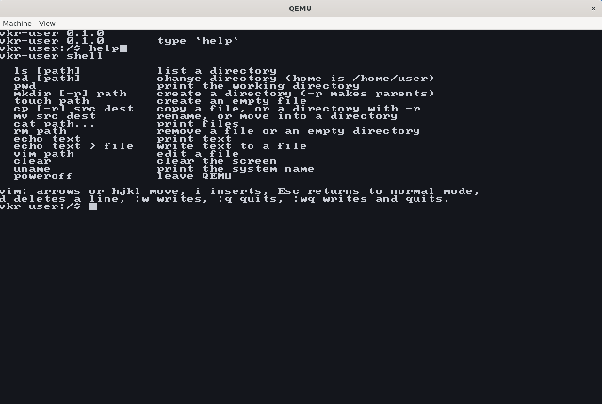
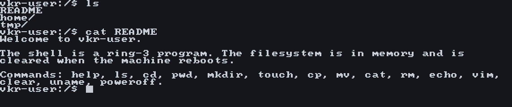
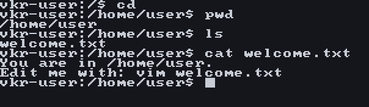
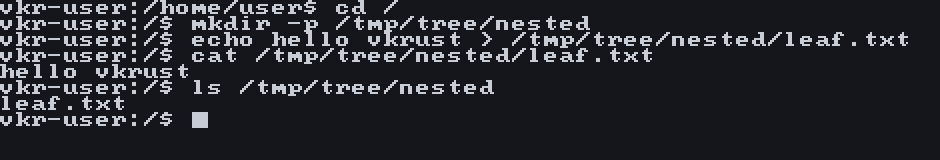
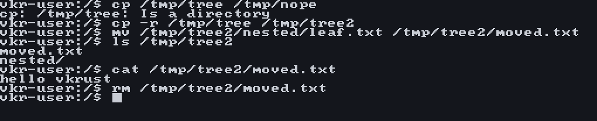
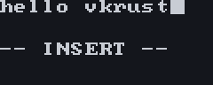
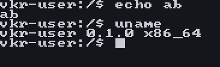

# VKRUST - Vibe Kernel in RUST

A small 64-bit x86_64 kernel and POSIX-style shell, both written in Rust. The `loader` crate is a UEFI application that reads the kernel from a CD image and jumps to it. The shell runs in ring 3 and can `ls`, `cd`, `mkdir`, `touch`, `cp`, `mv`, and edit files with `vim`. The filesystem is in memory. The architecture, with diagrams, is documented in [`doc/`](doc/README.md), including a [glossary](doc/README.md#glossary) of the terms those pages use.

## Build and run

Install the tools once:

```bash
sudo apt install xorriso qemu-system-x86 ovmf python3
```

If `xorriso` is missing and a Docker image named `vkrust-osdev` exists, `scripts/make-iso.sh` runs `xorriso` inside that image. The FAT image is built on the host with `python3`.

Rust nightly is selected by `rust-toolchain.toml`, with the `rust-src` component and the targets `x86_64-unknown-none` and `x86_64-unknown-uefi`. Then:

```bash
make
make run
```

`make` builds the shell, the kernel, the loader, and `target/vkrust.iso`. `make run` boots that ISO under OVMF. `scripts/qemu-fw.sh` picks the firmware. At the `vkr-user:/$ ` prompt, `help` lists the commands. Leave the guest with `poweroff`.

`make test` boots the ISO with no display and checks `ls`, `cd`, `mkdir`, `touch`, `cp`, `mv`, and `vim` over the serial port.

## Showcase

These frames are the guest framebuffer from `target/vkrust.iso`. Each one starts from `clear`, and the prompt is `vkr-user:/$ `.

### Help

```text
help
```



### Files present at boot

```text
ls
cat README
```



### Home directory

```text
cd
pwd
ls
cat welcome.txt
```



### Create a file

```text
cd /
mkdir -p /tmp/tree/nested
echo hello vkrust > /tmp/tree/nested/leaf.txt
cat /tmp/tree/nested/leaf.txt
ls /tmp/tree/nested
```



### Copy, move, and remove

```text
cp /tmp/tree /tmp/nope
cp -r /tmp/tree /tmp/tree2
mv /tmp/tree2/nested/leaf.txt /tmp/tree2/moved.txt
ls /tmp/tree2
cat /tmp/tree2/moved.txt
rm /tmp/tree2/moved.txt
```



### Vim

```text
vim /tmp/note.txt
```

Then `i` and `hello vkrust`. The picture keeps the buffer line and the `-- INSERT --` status line from the bottom of the screen.



### Backspace and uname

`echo abX`, then Backspace, then Enter. The `X` is gone before the line runs.

```text
uname
```



### Poweroff

`poweroff` is typed at the prompt. Enter leaves QEMU.


