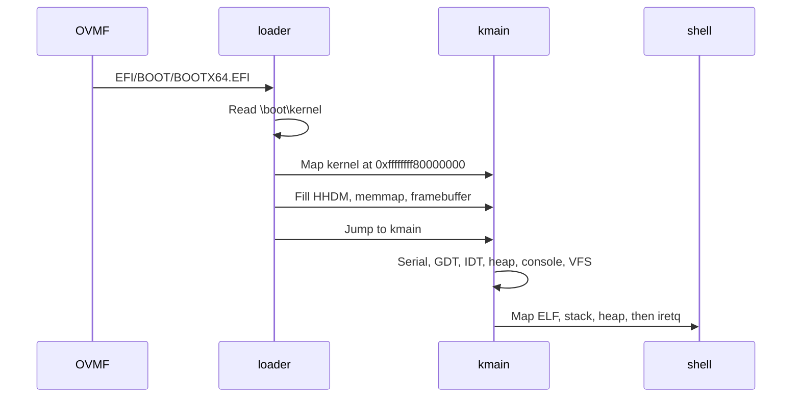

# Boot

vkr-user is a higher-half ELF. The loader in `loader/` reads it from the CD, builds page tables, and jumps to `kmain` with a [`BootInfo`](../bootinfo/src/lib.rs) pointer in `rdi`.

## The CD

`make` builds the shell, builds the kernel with that ELF embedded, builds the loader, then runs `scripts/make-iso.sh`.

`scripts/make-fat.py` writes a FAT12 image, `target/efi.img`, sized to two files:

| Path in the FAT image | Contents |
| --- | --- |
| `EFI/BOOT/BOOTX64.EFI` | The loader |
| `boot/kernel` | The vkr-user kernel ELF, shell included |

`xorriso` stores that image on `target/vkrust.iso` as the El Torito EFI boot image and as the EFI system partition behind a protective MBR. The same two files are copied onto the ISO9660 tree. OVMF sometimes opens the CD volume and sometimes opens the FAT image. The loader reads `\boot\kernel` from the volume it was started from, then scans the other volumes if that file is not there.

The cluster size is 512 bytes while the two files fit in fewer than 4,085 clusters, which is the FAT12 limit. Past that line the script doubles the cluster size and the volume stays FAT12. With the loader at 51,200 bytes and the kernel at 324,520 bytes, `efi.img` is 381,440 bytes and `target/vkrust.iso` is 1,171,456 bytes (1.12 MiB). The Limine ISO was 4,278,272 bytes (4.08 MiB), and 3,533,026 bytes of that were Limine's boot files.

`make run` and `make test` boot the ISO with OVMF. `scripts/qemu-fw.sh` prefers the combined firmware `/usr/share/ovmf/OVMF.fd` on QEMU's default `pc` machine, because the kernel programs an 8259 PIC. When that file is missing, the script uses the split 4 MiB firmware on `q35` and keeps a writable variable store at `target/ovmf-vars.fd`.

## What the loader hands over

The handoff lives in the `bootinfo` crate. `kmain` receives a pointer to one `BootInfo`. The record and the arrays it points at stay mapped for the life of the kernel. Every pointer in the record is a virtual address in the higher-half direct map.

| Field | Value |
| --- | --- |
| `hhdm_offset` | `0xffff800000000000`, the virtual address of physical byte 0 |
| `memory_map` | Usable RAM. `entry_type` 0 is usable, and the loader emits only that type |
| `framebuffer` | The current GOP mode, or null. Address, size, pitch, and the red, green, and blue mask shifts. A serial-only boot is allowed |

Usable ranges are conventional memory plus the boot-services code and data that become free when boot services end. The loader keeps its own pages out of that list: the kernel image, the page tables, the 128 KiB boot stack, the handoff block, and the trampoline page. When the framebuffer sits inside a usable range, that span is cut out so the frame allocator does not hand the screen to the heap.

ACPI tables and UEFI runtime-services memory stay unmapped. The kernel does not read them.

## From firmware to `kmain`

The loader is a UEFI application. While boot services are alive it allocates pages and reads files. It exits boot services before the jump.

1. Open `\boot\kernel` and copy each `PT_LOAD` segment into fresh pages. The kernel is linked at `0xffffffff80000000` with static relocation, so the link address is the run address. There is no relocation pass.
2. Allocate a 128 KiB stack, the handoff block, a 1 MiB page-table pool, and one page below 512 KiB for the jump stub.
3. Build a 4-level page table. Physical memory is mapped at `physical + 0xffff800000000000`, including the loader's own pages, so the kernel can walk page tables through that window. Kernel segments are mapped at their link addresses. The trampoline page is identity-mapped. The rest of the low half stays empty, so `0x400000` is free until `process::enter` maps the shell.
4. Exit boot services, write the usable map and the optional framebuffer into the handoff block, and jump. The stub loads a small 64-bit GDT, switches `CR3`, points `RSP` at the top of the boot stack, and enters `kmain` with `BootInfo` in `rdi`.

The kernel replaces that GDT at once. The loader's table only has to stay valid until `gdt::init`.

`kmain` is `extern "C" -> !`. It does not return to the loader.

The order inside `kmain` is the order the dependencies force:

1. **Serial.** COM1 is initialized first and prints `vkr-user kernel`. A panic from here on has a console that does not need the framebuffer or the heap.
2. **CR4.** SMAP and SMEP are cleared. Later, syscall code copies bytes from user addresses with ordinary pointer reads. SMAP would fault those reads. This happens before any user page exists, so the flag is already off when the first copy runs.
3. **`boot::take`.** Panic if the `BootInfo` pointer is missing or the memory map is empty. Stash the HHDM offset, the memory map, and the optional framebuffer.
4. **GDT and TSS.** Load the kernel code and data selectors and the task register. The IDT records the current CS when it is loaded, so the GDT comes first. Details are in [CPU](cpu.md).
5. **Input queues, then the IDT and the PIC.** `interrupts::init` programs the PICs, masks every IRQ except the keyboard and COM1, and executes `sti`. Interrupt handlers only touch the static byte rings allocated in step 5, so enabling interrupts before the heap is safe.
6. **Page-table walker and frame allocator.** The walker is the loader's table, reached through HHDM. The allocator yields usable frames at or above 1 MiB.
7. **Kernel heap.** 4 MiB mapped with supervisor pages. `console` is about to allocate a cell grid, and `vfs` is about to allocate the seed tree.
8. **Console, then VFS.** The framebuffer console mirrors to serial. The filesystem seeds `/`, `/home/user`, `/tmp`, `/README`, and `/home/user/welcome.txt`.
9. **`process::enter`.** Map the embedded shell, the user stack, and the user heap. `iretq` into ring 3. This function does not return.

## Leaving the machine

`exit_qemu` writes a `u32` to port `0xf4` and halts.

| Value | Who writes it | Meaning |
| --- | --- | --- |
| `0x10` | `poweroff`, or `exit` with status 0 | Success |
| `0x11` | A kernel panic, a fault handler, or `exit` with a non-zero status | Failure |

`make test` adds `-device isa-debug-exit,iobase=0xf4,iosize=0x04`. QEMU then turns the port value `v` into a process status of `(v << 1) | 1`, so success is process status 33 and failure is 35. A triple fault with `-no-reboot` exits 0 and prints nothing. That is a useful signal: status 0 means the CPU reset before a handler could speak.

The shell does not call `exit`. `poweroff` is the supported way out, and it takes the success path.
