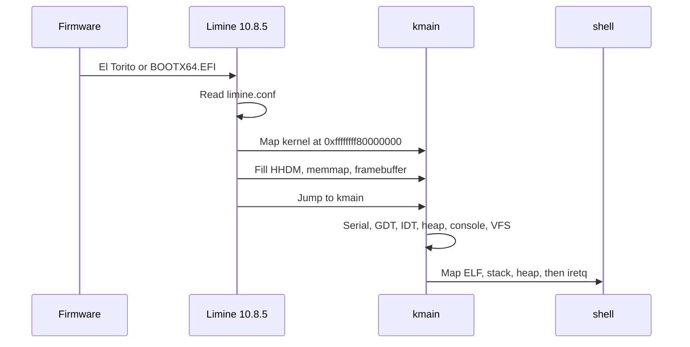

# Boot

vkr-user is a higher-half ELF. Limine loads it, writes answers into requests that live in `.data`, and jumps to `kmain`.

## The CD

`make` builds the shell, builds the kernel with that ELF embedded, then runs `scripts/make-iso.sh`.

The script clones the `v10.8.5-binary` tag of Limine into `target/limine` when the host tool is missing, and compiles it. The ISO root is:

| Path on the CD | Contents |
| --- | --- |
| `boot/kernel` | The vkr-user kernel ELF, shell included |
| `boot/limine/limine.conf` | Timeout 0, one entry, protocol `limine` |
| `boot/limine/limine-bios.sys` | BIOS stage, installed by `limine bios-install` |
| `boot/limine/limine-bios-cd.bin` | El Torito no-emulation boot image |
| `boot/limine/limine-uefi-cd.bin` | UEFI CD boot image |
| `EFI/BOOT/BOOTX64.EFI` | UEFI application |

`xorriso` writes a hybrid image: El Torito for BIOS, an EFI boot image, a protective MBR. `limine bios-install` then plants the BIOS stages. It reports that no partition was active and marks partition 1 active. That message is the installer fixing the MBR, and the image boots after it.

`limine.conf` names the kernel as `boot():/boot/kernel`. The `boot()` device is the device Limine itself was loaded from, so the same file works for the CD and for a copied tree.

## Why Limine, and why revision 4

The run command is `qemu-system-x86_64 -cdrom`. That needs a real CD image with a firmware path for BIOS and a firmware path for UEFI. Limine publishes both, and its protocol is a set of tagged structures in the kernel ELF rather than a custom boot stub linked into the kernel.

The tag this tree builds is **10.8.5**. That binary implements base revisions through 4. Revision 6 exists in the protocol document and arrived in Limine 11. Requesting a revision the loader does not implement leaves the revision word unchanged, and `kmain` panics with "Limine base revision is not supported." Pinning the tag and requesting revision 4 keeps the loader and the kernel in agreement.

The requests are written out in `kernel/src/boot.rs` to match the C protocol. They are `#[used]` and placed in `.requests`, between the start and end markers, inside the `.data` program header. The linker script `KEEP`s those sections. `boot::take` also references every request. Either step alone is enough to stop a smart linker from dropping a static that Rust thinks is unread; both are there because a dropped request looks exactly like a loader that ignored you.

## What the kernel asks for

| Request | What vkr-user asks | Why |
| --- | --- | --- |
| Base revision | 4 | The newest revision Limine 10.8.5 implements. After a successful boot the revision qword is 0. |
| Stack size | 128 KiB | The stack Limine uses to enter `kmain`. This is the boot stack, separate from the syscall stack. |
| Paging mode | mode, max, and min all 0 | 0 means 4-level paging. `OffsetPageTable` walks a 4-level table. |
| HHDM | the offset | Virtual address of physical byte 0. Adding it to a physical address yields a pointer the kernel can dereference. |
| Memory map | the entries | Usable RAM for the frame allocator. Type 0 is usable. |
| Framebuffer | the first one, if any | Pixel buffer, pitch, and RGB masks. A serial-only boot is allowed. |

Revision 4's higher-half map covers usable RAM, bootloader-reclaimable memory, the kernel, modules, the framebuffer, ACPI, and reserved regions that the firmware mapped. Limine dropped the low identity map at revision 1, so the addresses where the shell will live are empty until `process::enter` maps them. That is what we want: user pages exist only where the loader created them.

## From firmware to `kmain`

`kmain` is `extern "C" -> !`. It does not return to Limine.

The order inside `kmain` is the order the dependencies force:

1. **Serial.** COM1 is initialized first and prints `vkr-user kernel`. A panic from here on has a console that does not need the framebuffer or the heap.
2. **CR4.** SMAP and SMEP are cleared. Later, syscall code copies bytes from user addresses with ordinary pointer reads. SMAP would fault those reads. This happens before any user page exists, so the flag is already off when the first copy runs.
3. **`boot::take`.** Panic if the base revision was not accepted. Stash the HHDM offset, the memory map, and the optional framebuffer.
4. **GDT and TSS.** Load the kernel code and data selectors and the task register. The IDT records the current CS when it is loaded, so the GDT comes first. Details are in [CPU](cpu.md).
5. **Input queues, then the IDT and the PIC.** `interrupts::init` programs the PICs, masks every IRQ except the keyboard and COM1, and executes `sti`. Interrupt handlers only touch the static byte rings allocated in step 5, so enabling interrupts before the heap is safe.
6. **Page-table walker and frame allocator.** The walker is Limine's table, reached through HHDM. The allocator yields usable frames at or above 1 MiB.
7. **Kernel heap.** 4 MiB mapped with supervisor pages. `console` is about to allocate a cell grid, and `vfs` is about to allocate the seed tree.
8. **Console, then VFS.** The framebuffer console mirrors to serial. The filesystem seeds `/`, `/home/user`, `/tmp`, `/README`, and `/home/user/welcome.txt`.
9. **`process::enter`.** Map the embedded shell, the user stack, and the user heap. `iretq` into ring 3. This function does not return.

## Leaving the machine

`exit_qemu` writes a `u32` to port `0xf4` and halts.

| Value | Who writes it | Meaning |
| --- | --- | --- |
| `0x10` | `poweroff`, or `exit` with status 0 | Success |
| `0x11` | A kernel panic, a fault handler, or `exit` with a non-zero status | Failure |

`make test` adds `-device isa-debug-exit,iobase=0xf4,iosize=0x04`. QEMU then turns the port value `v` into a process status of `(v << 1) | 1`, so success is process status 33 and failure is 35. A triple fault with `-no-reboot` exits 0 and prints nothing. That is a useful signal: status 0 means the CPU reset before a handler could speak.

The shell does not call `exit`. `poweroff` is the supported way out, and it takes the success path.
