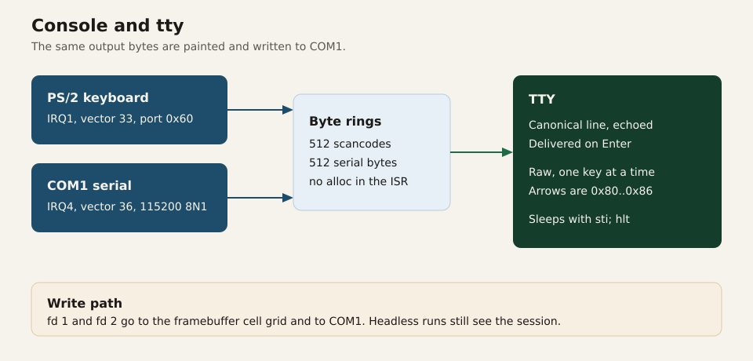

# Console

The shell sees a terminal. The terminal is a framebuffer grid when QEMU provides a framebuffer, and it is always COM1. Input arrives from the PS/2 keyboard and from the serial port, and the tty turns both into the same byte stream.

## Output

`write` to fd 1 or fd 2 calls `console::write_bytes`. Those bytes are painted into the cell grid and handed to COM1. A headless test and a windowed boot therefore see one session. `make test` reads COM1 and does not need the framebuffer.

If the loader provides no framebuffer, painting is skipped and `TIOCGWINSZ` reports 24 rows by 80 columns. With a framebuffer, the grid is derived from the mode. Modes at least 900 pixels wide scale the 8×8 glyph by two, so a 1280×800 window is still a modest number of columns rather than a tiny font.

Glyphs come from `font8x8`. The basic font is indexed by Unicode scalar, and the least significant bit of a row is the leftmost pixel. Cells store a character and are `Copy`. The parser accepts the ANSI sequences the shell and vim actually emit:

| Sequence | Effect |
| --- | --- |
| `\n` | Next row, column 0 |
| `\r`, backspace, tab | Column motion |
| `ESC[2J` | Clear the screen |
| `ESC[H` and `ESC[row;colH` | Move the cursor |
| `ESC[K` | Clear to the end of the line |

`clear` in the shell sends `ESC[2J` and then `ESC[H`. vim redraws the whole grid the same way on every key.

Pixels use the red, green, and blue mask shifts from the framebuffer handoff. The code does not assume a channel order beyond what the masks say. QEMU's GOP mode is usually BGR, so the red shift is 16. The loader sets `memory_model` to 1 and the console does not read that field.

## Input devices

Both devices are interrupt-driven. The PIC setup is in [CPU](cpu.md): vector 33 for the keyboard, vector 36 for COM1, timer masked.

The keyboard ISR reads port `0x60` and pushes the scancode into a 512-byte ring. The serial ISR drains COM1's received-data bit into a second 512-byte ring. A full ring drops the new byte. Neither handler allocates, formats, or takes the tty mutex. They send EOI and return.

COM1 itself is 115200 baud, 8 data bits, no parity, one stop bit. The line-status register's data-ready bit is polled when the tty drains, as well as the IRQ, so a byte that arrived before the interrupt handler ran is still observed. Transmit is a spin on the transmitter-empty bit, with interrupts disabled around the serial lock so a print from a handler and a print from `kmain` cannot interleave inside a byte.

## The tty

`input::read` is what `read(0)` blocks in.

1. Disable interrupts.
2. Drain COM1 into the serial ring, in case the IRQ has not run.
3. Decode both rings into keys.
4. Copy already-pending bytes into the user buffer.
5. If something was copied, enable interrupts and return.
6. If the pending queue is empty, drop the tty lock, then `sti; hlt`.

The lock is dropped before `hlt` so a future change can take it from another context without deadlocking the only CPU against itself. The `sti; hlt` pair is the lost-wakeup protocol: an interrupt after `sti` and before `hlt` still wakes the processor, because the interrupt window is open. Disabling interrupts at the start of the next loop closes the window again before the queues are inspected.

### Canonical mode

This is the shell's mode. Printable bytes are appended to a line and echoed. Backspace removes one byte and writes `\b \b` so the cell disappears. Enter appends `\n`, echoes a newline, and moves the whole line into the pending queue for `read`.

Arrow keys, Home, End, and Delete are ignored in this mode. The prompt is a line, not an editor. History and cursor motion inside the line are not implemented. Vim does not use this mode.

### Raw mode

`ioctl(TCSETS)` with argument 1 switches to raw mode and discards any partial canonical line. Argument 0 switches back. Vim does this around its loop.

In raw mode each key becomes one byte, or a short fixed sequence, with no echo:

| Key | Byte |
| --- | --- |
| Enter | `\n` |
| Backspace | `0x7f` |
| Escape | `0x1b` |
| Up, Down, Right, Left | `0x80`, `0x81`, `0x82`, `0x83` |
| Home, End, Delete | `0x84`, `0x85`, `0x86` |
| ASCII | the byte itself |

The values from `0x80` upward are vkr-user's, defined in `abi`. They are not ANSI. The kernel collapses both input sources onto these bytes so vim does not carry a decoder for PS/2 and another for serial.

Serial ANSI sequences are decoded in the kernel. `ESC [` plus `A`/`B`/`C`/`D`/`H`/`F` becomes an arrow, Home, or End. `ESC [3~` becomes Delete. A bare `ESC` whose next byte is not `[` is delivered immediately as Escape. That is the right behavior for vim's Esc key when the byte is alone. An arrow key only decodes if the following bytes are already in the ring; the decoder does not wait across a `read`.

The PS/2 path uses `pc-keyboard` with scancode set 1 and a UK 105-key layout. Key releases are passed to the decoder so Shift, Ctrl, and Alt turn off again. The decoded character is mapped onto the same `Key` enum as the serial path. `£` and `¬` are kept as Latin-1 bytes.

## Why the tty is in the kernel

The alternative is to hand the shell raw scancodes and let it implement echo, backspace, and ANSI arrows. Then every program would repeat that, and a blocking `read` would spin or would need a way to wait for an IRQ. vkr-user has one program, but the wait has to be in the kernel anyway: `hlt` with interrupts off does not see the keyboard, and `hlt` with a lock held is how a single CPU deadlocks.

Putting the line discipline next to the IRQ handlers keeps `read` a blocking syscall, which is what the shell's loop expects, and it gives vim a raw mode that is still just `read`.
