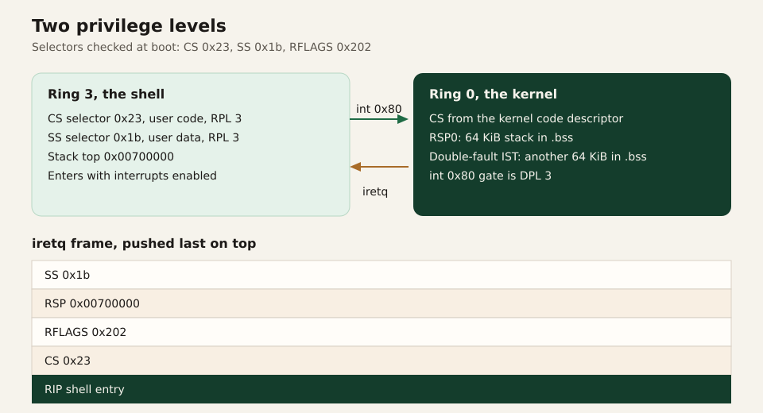

# CPU

The shell runs at ring 3. Everything else runs at ring 0. The GDT defines the segments, the TSS defines the stacks used on the way in, and the IDT defines the entries.

## The GDT

`gdt::init` builds one table and loads it before the IDT exists.

| Slot | Descriptor | Selector at ring 0 | Selector the shell uses |
| --- | --- | --- | --- |
| 0 | Null | | |
| 1 | Kernel code | `0x08` | |
| 2 | Kernel data | `0x10` | |
| 3 | User data | `0x18` | `0x1b` (RPL 3) |
| 4 | User code | `0x20` | `0x23` (RPL 3) |
| 5 | TSS | loaded with `ltr` | |

`user_cs` and `user_ss` rebuild the user selectors with `PrivilegeLevel::Ring3`. The hardware checks that the RPL in the selector matches the descriptor's privilege. A ring-0 user selector on an `iretq` into user code is rejected. The boot log prints the pair it is about to use (`cs=0x23 ss=0x1b`). Those two numbers are the check that the table was built in this order.

User data is appended before user code because that is the order the selectors above assume. Swapping them would silently swap `0x1b` and `0x23`.

The TSS is a 16-byte system descriptor, so it occupies two GDT slots. Nothing is appended after it.

## Stacks the CPU pushes onto

A ring transition needs a stack that the user program does not own.

| Stack | Size | TSS field | Who uses it |
| --- | --- | --- | --- |
| `RSP0_STACK` | 64 KiB | privilege stack 0 | Any interrupt or exception taken while the CPU is in ring 3, including `int 0x80` |
| `DF_STACK` | 64 KiB | IST slot 0 | The double-fault gate |

Both arrays are `#[link_section = ".bss"]`. A `static` that Rust can prove is all zeros would otherwise land in `.rodata`. The CPU pushes an interrupt frame with ordinary stores. A read-only stack turns the first ring-3 fault into a page fault, and a read-only double-fault stack turns that into a triple fault. QEMU then exits 0 and the serial log never shows the original fault. Putting the stacks in `.bss` is the fix, and it is why the comment in `gdt.rs` is there.

The double-fault handler is registered with `set_stack_index(DOUBLE_FAULT_IST)` where that constant is 0, and the TSS is filled at `interrupt_stack_table[0]`. The gate and the TSS slot are the same index in the source.

Limine's 128 KiB stack is only the stack that enters `kmain`. By the time the shell runs, ring-3 entries use `RSP0_STACK`.

## Entering ring 3

`process::enter` finishes the mappings, records the user regions, and executes `iretq`. The five words it pushes, from the bottom of the frame up to the top of the stack, are:

| Word | Value | Meaning |
| --- | --- | --- |
| SS | `0x1b` | User stack segment |
| RSP | `0x00700000` | Empty user stack, top exclusive |
| RFLAGS | `0x202` | Interrupt flag set, IOPL 0 |
| CS | `0x23` | User code segment |
| RIP | ELF entry | `_start` of the shell |

`0x202` is bit 1 (reserved, always 1) and bit 9 (IF). The shell runs with interrupts enabled, so a keypress can land while it is thinking. IOPL is 0, so a user `in` or `out` faults. The shell talks to the serial port through `write`, not through port I/O.

The entry point then calls the shell allocator and `shell::run`. `shell::run` loops forever. Returning from the shell is not a path we implement.

## The IDT

| Vector | Handler | Privilege | Stack |
| --- | --- | --- | --- |
| Breakpoint (3) | print and continue | ring 0 | RSP0 if from ring 3 |
| Invalid opcode (6) | print, exit `0x11` | ring 0 | RSP0 if from ring 3 |
| Double fault (8) | print, exit `0x11` | ring 0 | IST 0 |
| General protection (13) | print, exit `0x11` | ring 0 | RSP0 if from ring 3 |
| Page fault (14) | print CR2 and the code, exit `0x11` | ring 0 | RSP0 if from ring 3 |
| 33 | keyboard, EOI | ring 0 | current stack if already in ring 0 |
| 36 | serial, EOI | ring 0 | current stack if already in ring 0 |
| `0x80` | naked syscall stub | **ring 3** | RSP0 |

Fault handlers stop the machine. There is no signal and no `panic` inside the handler beyond the serial line and the exit port. A double fault means the first handler already failed; its only job is to say so on a stack that is still writable.

The `0x80` gate is the one gate with DPL 3. Any other software interrupt from the shell is a general-protection fault. That is the whole system-call surface: one instruction, one vector.

## PIC

The legacy PIC is remapped to vectors 32 and 40 so hardware IRQs do not collide with CPU exceptions. After the remap, the master mask is `0xED` and the slave mask is `0xFF`.

`0xED` leaves two bits clear: IRQ1 (keyboard, vector 33) and IRQ4 (COM1, vector 36). Everything else on the master is masked, including IRQ0, the timer. The slave is fully masked.

The timer is masked on purpose. An unmasked IRQ0 with no handler that sends EOI locks the PIC, and then the keyboard never arrives. vkr-user has nothing to do on a tick. Masking the timer is the scheduler policy, expressed as a bitmask.

IRQ handlers read the device, push into a fixed ring, send EOI, and return. They do not take the tty lock and they do not allocate. The tty drains the rings later, with interrupts disabled, so a handler cannot interleave with a drain.

## The syscall stub

`syscall_entry` is naked. The CPU has already pushed the interrupt frame. The stub then pushes ten registers: `rax`, `rcx`, `rdx`, `rsi`, `rdi`, `r8`, `r9`, `r10`, `r11`, `rbx`.

RSP0 is 16-byte aligned. The CPU's five qwords leave RSP ≡ 8 (mod 16). The ten register pushes are 80 bytes, so RSP is still ≡ 8 (mod 16) at the `call`. The comment on `syscall_entry` records that count. The trampoline is `extern "C"`. It receives the saved block in `rdi`, calls `syscall::dispatch`, and writes the `i64` result back over the saved `rax`.

The System V rule for a normal call is the other residue: RSP should be ≡ 0 (mod 16) immediately before `call`, which makes it ≡ 8 (mod 16) on entry once the return address is on the stack. The stub is 8 bytes away from that rule. The shell's syscalls still return, because today's dispatcher does not spill an SSE register with an aligned store that would fault. A handler that does should push one extra qword before the `call` and pop it afterward.

The pops reverse the pushes, and `iretq` consumes the CPU frame. The shell sees the return value in `rax` and its other argument registers restored. XMM registers are not in this list. The shell's `asm!` block uses `clobber_abi("sysv64")` so the compiler treats XMM and the other caller-saved registers as killed across `int 0x80`. The kernel is ordinary Rust and may use SSE between the interrupt and the return.

## Why `int 0x80`

The Linux `syscall` instruction needs `STAR`, `LSTAR`, and `EFER.SCE`, and it does not go through the IDT. `int 0x80` needs a gate with DPL 3, which is one line next to the other gates, and it reuses the RSP0 path that faults already use.

The register convention is still the Linux one, so the numbers in `abi` are the Linux x86_64 numbers: `rax` selects the call, `rdi`/`rsi`/`rdx`/`r10` are the arguments, `rax` comes back as a count or as `-errno`. People reading the shell can match `SYS_READ = 0` and `SYS_OPEN = 2` against a Linux table. The fourth argument is `r10`, not `rcx`, because that is the Linux convention: `syscall` clobbers `rcx`, and vkr-user keeps the same layout even though `int 0x80` does not.

Argument and return details are in [Syscalls](syscalls.md).
