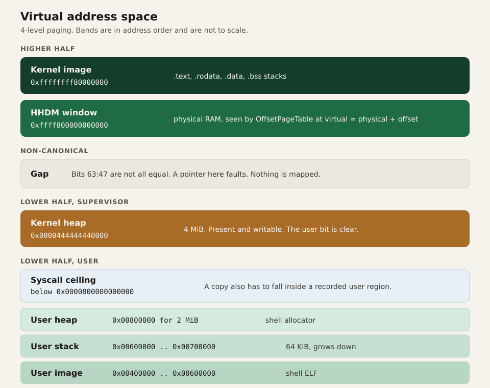

# Memory

vkr-user keeps the loader's page tables. It adds a bump allocator for physical frames and two virtual heaps: one for the kernel, one for the shell.

## Why these addresses

The kernel is linked at `0xffffffff80000000` with `code-model=kernel` and `relocation-model=static`.

The high address is the higher-half window the loader maps the kernel into. `code-model=kernel` tells LLVM the kernel lives in the top 2 GiB of the address space, so it can reach its own data with normal addressing. `relocation-model=static` means the ELF has no dynamic relocations: the link address is the run address. The linker script puts `.text`, `.rodata`, and `.data`/`.bss` in three `PT_LOAD` segments. The loader copies those segments onto fresh frames and maps them at the link address.

The shell is linked at `0x400000`, also with static relocation, and with a 4 KiB maximum page size. It is a low, fixed executable. The kernel maps whatever `PT_LOAD` says, so the link address and the run address are the same number and there is no loader relocation pass to write.

The user image is allowed to occupy `[0x400000, 0x600000)`. The top of that window is the base of the user stack. A segment that would cross into the stack is a panic at load time, which is earlier and louder than a stack smash.

The kernel heap is at `0x0000444444440000` for 4 MiB. That is in the lower canonical half, far above the shell. It is mapped present and writable, without the user bit. The syscall check does not treat "lower half" as "user." A pointer is user memory only when it falls inside a region `process::enter` recorded. The weird constant is there so a glance at a fault address tells you which heap you are in.

## HHDM and `OffsetPageTable`

The higher-half direct map is a window where virtual address = physical address + `0xffff800000000000`. `boot::take` saves that offset. `memory::mapper` reads CR3, adds the offset, and builds an `OffsetPageTable` on that pointer.

New frames are zeroed through the same window before they are mapped to their virtual address. The loader identity-maps one trampoline page below 512 KiB and leaves the rest of the low half empty. The frame allocator skips everything below 1 MiB, so that page is never handed out. User mappings are created explicitly.

## The frame allocator

`FrameAlloc` keeps up to 64 usable regions from the loader's memory map.

- Entries whose type is not usable are ignored.
- The region is rounded inward to whole 4 KiB frames.
- Frames below 1 MiB are skipped. That range belongs to firmware tables and the legacy PC hole.
- Allocation is a counter. Frame *n* is the n-th frame of the flattened list.

A bump counter is enough because the machine maps a few megabytes and never frees a frame. The heap, the shell, the user stack, and the page tables themselves are the only clients. Freeing would matter the day something unmaps a page. Nothing does.

`map_page` has one special case. If the virtual page is already translated, the existing frame is kept and `update_flags` applies the requested flags. The shell's ELF puts the end of one segment and the start of the next on the same 4 KiB page. Unmapping that page to "map it again" would wipe bytes that were just copied. Updating flags preserves them and still sets the user bit.

## What gets mapped for the shell

`process::enter` maps three things with `PRESENT | WRITABLE | USER_ACCESSIBLE`:

| Region | Range | Size |
| --- | --- | --- |
| ELF `PT_LOAD` segments | inside `0x400000 .. 0x600000` | whatever the ELF says |
| User stack | `0x00600000 .. 0x00700000` | 64 KiB, top exclusive |
| User heap | `0x00800000` for 2 MiB | shell `LockedHeap` |

File bytes are copied into the new mapping at the segment's virtual address. The memory size may be larger than the file size; the extra bytes stay zero because the frame was zeroed. That is how `.bss` arrives as zeros.

Every one of those pages is writable and executable. The page-table entry does not set the NX bit. The ELF's `PF_X` and `PF_W` bits are not consulted. The reason is the shared page above: two segments with different wishes occupy one frame, and a later `update_flags` would have to pick a winner. One flag set for the whole user image keeps the loader obvious. The cost is that the shell can write its own text and execute its heap. With one cooperative program, that cost is accepted.

## Recorded regions

After the mappings exist, the loader records up to eight `[start, end)` ranges and hands them to the syscall code:

1. The user stack.
2. The user heap.
3. Each `PT_LOAD` segment, rounded out to pages.

A syscall copy must be entirely inside one recorded range, and the end must be at or below `0x0000800000000000`. That second test rejects a non-canonical pointer even if a buggy region were ever recorded up there. The kernel heap is below that ceiling and is still rejected, because it is not one of the eight ranges.

Eight is a fixed array so the check does not allocate. The current shell has four load segments plus the stack plus the heap, which is six. A seventh and eighth fit. Past that, extra segments would be mapped and then invisible to the checker, so a syscall pointer into them would fail. The cap is part of the format of this kernel, not a property of ELF.

## The two allocators

Both heaps use `linked_list_allocator`.

The kernel heap starts after the console and the VFS need it, and after interrupts are on. Interrupt handlers do not allocate. They push a byte into a fixed ring and return. That is why an IRQ during `Vec` growth cannot re-enter the allocator.

The shell heap starts in `_start`, before `shell::run`. The size passed to `init` is a `usize` of 2 MiB. The shell has its own copy of the allocator. Kernel allocations and shell allocations do not share a free list, because they do not share a mapping.

## Faults

A page fault, a general-protection fault, an invalid opcode, or a double fault prints the frame on serial and exits QEMU with `0x11`. There is no demand paging and no signal delivered to the shell. A bad pointer in the shell ends the machine. That matches a kernel whose only recovery policy is "print it and stop."
