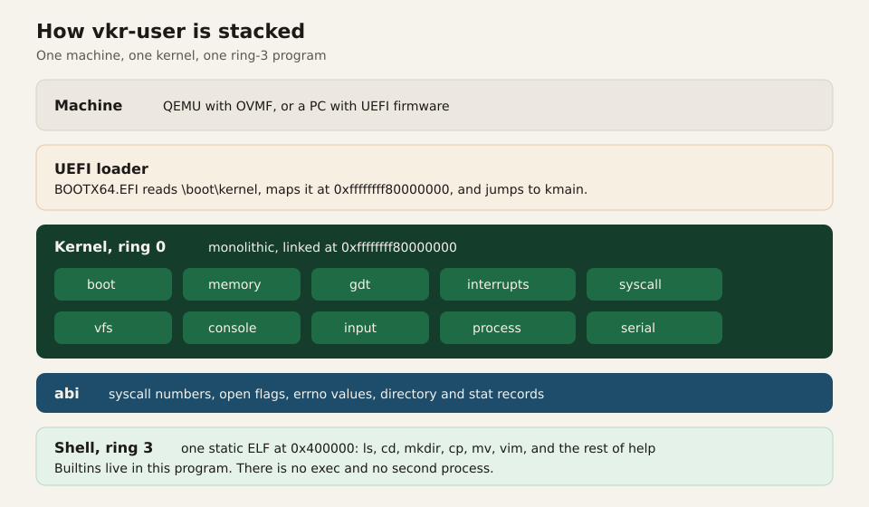
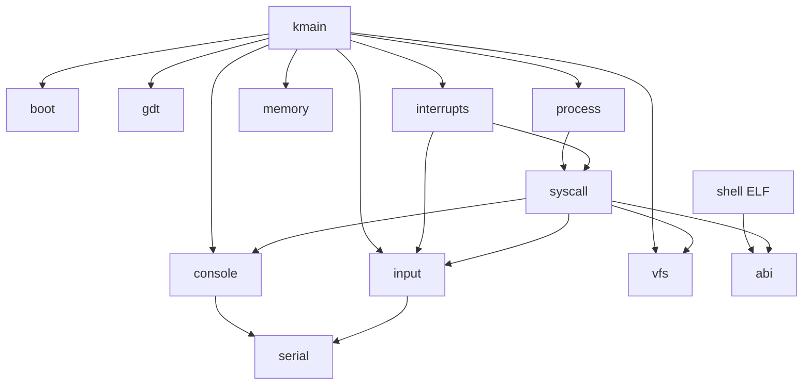

# Overview

vkr-user exists to boot on QEMU and give you a shell. The shell has to be able to list a directory, move around, create files and directories, copy and rename them, and edit a file. That goal decides the architecture.

## What runs

There is one kernel and one user program.

The kernel is monolithic. Drivers, the filesystem, the tty, and the syscall dispatcher are functions in the same address space. A call from `syscall` into `vfs` is an ordinary Rust call.

The user program is the shell. `ls`, `cd`, `mkdir`, `cp`, `mv`, and `vim` are functions inside that program. The kernel never loads a second ELF. There is no `fork` and no `exec`.

The `abi` crate is the contract between them: syscall numbers, open flags, errno values, and the C layout of a directory entry, a `stat` result, and a window size. Both sides include it. Neither side reaches into the other's types by accident.

## Module graph

Arrows mean "calls into" during a normal boot and a normal syscall. Hardware interrupts are the other entry into the kernel.

`process::enter` does not return. After `iretq`, the only way back into the kernel is an interrupt: a fault, a keyboard or serial IRQ, or `int 0x80`.

## Why the kernel is this small

The interesting part of the project is the boundary between the shell and the kernel: paging, a ring transition, a syscall ABI, a filesystem, and a tty. A scheduler, a disk driver, and a dynamic linker are each larger than that boundary, and the shell does not need them.

So the design stops at one process:

- Scheduling is "the shell runs until it makes a syscall or a device IRQ fires." The timer IRQ stays masked, so nothing preempts the shell on a tick.
- Storage is RAM. `vfs` is a vector of nodes. Rebooting clears it. The seeded `README` says so.
- Programs are one static ELF, embedded in the kernel image with `include_bytes!`. The CD carries the loader and one kernel file, `boot/kernel`.
- Trust is the trust of a demo. The kernel turns off SMAP so it can copy syscall buffers with ordinary loads. See [CPU](cpu.md) and [Syscalls](syscalls.md).

## Choices

Each row is a constraint from the goal, and the mechanism that satisfies it.

| Goal | How vkr-user meets it |
| --- | --- |
| `make run` boots the image under QEMU | UEFI CD: OVMF loads `EFI/BOOT/BOOTX64.EFI` from the FAT image |
| The kernel receives a memory map and an optional framebuffer | `BootInfo` in `rdi`, filled by the loader before the jump |
| Page tables stay something `OffsetPageTable` can walk | The loader builds 4-level tables and a higher-half direct map |
| The shell is protected from a bad pointer in the kernel's own heap | User copies are allowed only inside regions recorded at load time |
| `ls` and `vim` work with no disk | In-memory VFS, seeded with `/`, `/home/user`, `/tmp`, and two text files |
| The editor and the shell share a keyboard | Kernel tty. Canonical mode for the prompt, raw mode for vim |
| Headless `make test` sees what the window sees | Console writes go to the framebuffer and to COM1 |
| Leave the guest from the prompt | `poweroff` is a syscall that writes the QEMU debug-exit port |

## Language and toolchain

The kernel and the shell are `no_std` and use the `alloc` crate. Their target is `x86_64-unknown-none`. That target has no red zone, which matters for interrupt code. The loader is `no_std` as well and targets `x86_64-unknown-uefi`. The `bootinfo` crate is the `repr(C)` handoff they share.

`rust-toolchain.toml` selects nightly because the kernel uses `abi_x86_interrupt` for the fault and IRQ handlers. The syscall entry itself is a naked function, because the CPU arrives there with an interrupt frame already on the stack and the handler has to save registers by hand.

Panics abort. There is no unwinder. A kernel panic prints to serial and asks QEMU to exit. A shell panic writes to file descriptor 1 and exits with status 101.

Release builds use one codegen unit and leave LTO off, so a rebuild stays cheap while the image is still a single optimized ELF.

## What you can hold onto while reading the rest

Three addresses show up everywhere:

| Address | What lives there |
| --- | --- |
| `0xffffffff80000000` | Kernel link address |
| `0x400000` | Shell link address |
| `0x00700000` | Top of the user stack |

The next pages walk from power-on to a prompt, then through memory, the CPU, syscalls, files, the console, and the shell.
