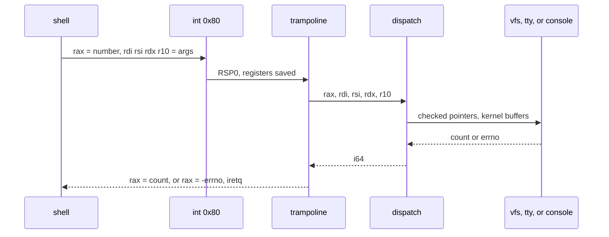

# Syscalls

Every request from the shell is `int 0x80`. The gate is DPL 3, the stub is the naked function in [CPU](cpu.md), and `syscall::dispatch` is an ordinary match on `rax`.

## The call

The shell wrapper is `user/src/syscall.rs`. It uses `inlateout("rax")` so the number goes out and the result comes back in the same register. The other arguments are `rdi`, `rsi`, `rdx`, and `r10`. `clobber_abi("sysv64")` tells the compiler that the kernel may use caller-saved registers, including XMM. Without that, a value kept in XMM across a syscall could come back destroyed the first time the kernel used SSE.

A negative return is an errno. `check` negates it into the `Err` side. Zero and positive returns are byte counts or file descriptors, and for calls that only succeed or fail the shell ignores the zero.

Paths are C strings. The wrapper copies the Rust string onto the heap and appends a zero. The kernel reads bytes until that zero, or until 256 bytes, and returns `ENAMETOOLONG`.

## Numbers

The values are the Linux x86_64 syscall numbers, so a table of Linux calls is a readable index. vkr-user implements this subset.

| `rax` | Name | Arguments | Success |
| --- | --- | --- | --- |
| 0 | `read` | fd, buffer, length | bytes copied |
| 1 | `write` | fd, buffer, length | bytes copied |
| 2 | `open` | path, flags | file descriptor |
| 3 | `close` | fd | 0 |
| 4 | `stat` | path, `Stat` out | 0 |
| 16 | `ioctl` | fd, request, argument | 0 |
| 60 | `exit` | status | does not return |
| 79 | `getcwd` | buffer, length | length without a NUL |
| 80 | `chdir` | path | 0 |
| 82 | `rename` | from, to | 0 |
| 83 | `mkdir` | path | 0 |
| 87 | `unlink` | path | 0 |
| 169 | `reboot` | ignored | does not return |
| 217 | `getdents` | fd, `DirEntry` out, size | byte size of one `DirEntry`, or 0 at the end |

Anything else returns `-ENOSYS` (38).

`open` flags follow the Linux values too: `O_RDONLY` 0, `O_WRONLY` 1, `O_RDWR` 2, `O_CREAT` `0x40`, `O_TRUNC` `0x200`, `O_APPEND` `0x400`, `O_DIRECTORY` `0x10000`.

## Where each call goes

| Call | Kernel path |
| --- | --- |
| `read` on fd 0 | Drain the tty. This may `hlt` until a key arrives. |
| `read` on any other fd | `vfs::read` at the file offset |
| `write` on fd 1 or 2 | Framebuffer and COM1. The VFS is not involved. |
| `write` on any other fd | `vfs::write` |
| `open`, `close`, `stat`, `mkdir`, `unlink`, `rename`, `chdir`, `getcwd`, `getdents` | `vfs` |
| `ioctl` `TCSETS` (`0x5402`) | Set the tty raw or canonical. The argument is 1 or 0. fd must be 0 or 1. |
| `ioctl` `TIOCGWINSZ` (`0x5413`) | Write a `WinSize` of rows and columns. fd must be 0 or 1. |
| `exit` | Port `0xf4`. Status 0 writes `0x10`. Anything else writes `0x11`. |
| `reboot` | Port `0xf4` with `0x10`. This is `poweroff`. |

`close` on fd 0, 1, or 2 succeeds and does nothing. Those slots are the tty for the life of the boot.

File descriptors from `open` start at 3 and stop at 31. Descriptor 32 does not exist. A full table returns `ENOSPC`.

## User pointers

`dispatch` never trusts a pointer from `rdi`.

`user_ok` requires:

- the range does not wrap,
- the end is at or below `0x0000800000000000`,
- the whole range sits inside a single region recorded when the shell was loaded.

The recorded regions are the ELF image, the user stack, and the user heap. The kernel heap is in the lower canonical half and is still rejected, because it was never recorded. That is the check that keeps a shell bug from making `read` write the kernel heap.

Copies are capped at 1 MiB per call. The kernel allocates a temporary with the kernel allocator, copies, then calls the VFS or the console. The VFS lock is not held while the tty waits for a key. `read` on fd 0 fills the temporary from the tty first, then copies out to the user buffer.

SMAP is off, so the copy itself is a `copy_nonoverlapping`. The region check is what makes that safe. With SMAP on, the same copy would fault unless it ran in a section that cleared the flag around the access. vkr-user picks the smaller mechanism.

## `ioctl` and the window

`TCSETS` is how vim switches the keyboard. The shell stays canonical. vim calls `set_raw(true)` on entry and `set_raw(false)` on the way out, including when it returns an error from the setup path only if `set_raw` itself fails. A later editor error still restores the mode in the success path of `edit`; a failed `set_raw` never enters the loop.

`TIOCGWINSZ` reports the framebuffer cell grid. With no framebuffer, the console reports 24 rows and 80 columns, and vim uses that.

## Errors the shell prints

`abi::errno_name` turns a code into a sentence. The shell prints `command: path: sentence`.

| Code | Name in the source | Sentence |
| --- | --- | --- |
| 2 | `ENOENT` | No such file or directory |
| 5 | `EIO` | Input/output error |
| 9 | `EBADF` | Bad file descriptor |
| 14 | `EFAULT` | Bad address |
| 17 | `EEXIST` | File exists |
| 20 | `ENOTDIR` | Not a directory |
| 21 | `EISDIR` | Is a directory |
| 22 | `EINVAL` | Invalid argument |
| 25 | `ENOTTY` | Inappropriate ioctl |
| 28 | `ENOSPC` | No space left |
| 36 | `ENAMETOOLONG` | File name too long |
| 38 | `ENOSYS` | Function not implemented |
| 39 | `ENOTEMPTY` | Directory not empty |

A code with no sentence, including the editor's 27 when a file is larger than 256 KiB, prints as `Error`. A return of `Err(0)` from a builtin means the builtin already printed its own line. `error` stays quiet for 0, so the line is not printed twice.

## What the shell does with this

The builtins are thin. `cat` is `open`, `read`, `write`, `close`. `cp` is that in a loop, plus `mkdir` for directories. `mv` is one `rename` per source. The kernel does not know the names `cp` and `mv`. It knows `read`, `write`, `mkdir`, and `rename`. The split is described in [Userland](userland.md) and [Filesystem](vfs.md).
