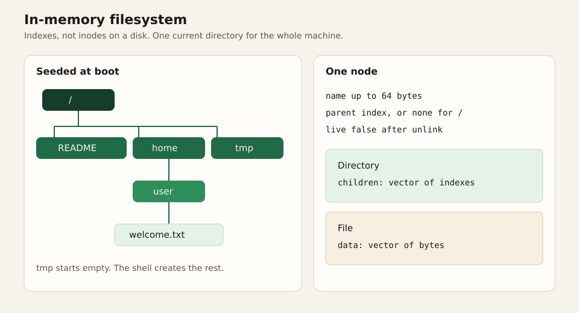

# Filesystem

There is no disk. `vfs` is a `Vec` of nodes behind one mutex. Rebooting throws it away. That is a deliberate boundary: a shell can be real while a block device and a crash-consistent format are still out of scope.

## The node

A node is an index into the vector. The index is stable for the life of the node. Unlink does not compact the vector. It clears `live` and unlinks the index from the parent's child list. An open file descriptor keeps the index, so a file that was unlinked while open can still be read and written until the last descriptor closes. Nothing walks a dead node by name.

| Field | Role |
| --- | --- |
| `name` | One path component, at most 64 bytes. `/` is not a legal character inside it. |
| `parent` | Index of the directory that contains this node. `/` has none. |
| `live` | Cleared by unlink and by the replace half of `rename`. |
| `Dir { children }` | Indexes of the entries. Order is insertion order. `ls` sorts in the shell. |
| `File { data }` | The bytes. |

There are no `.` or `..` entries stored in the child list. Path lookup understands those two names when it walks a string. `getdents` therefore does not yield them, and `ls` does not print them.

The root is index 0. Its name is empty. `getcwd` walks parents until it hits that node and joins the names with slashes, so the root prints as `/` and `/home/user` prints as `/home/user`.

## What boot creates

| Path | Kind | Contents |
| --- | --- | --- |
| `/` | directory | |
| `/README` | file | A short description of the shell and the memory filesystem |
| `/home` | directory | |
| `/home/user` | directory | The directory a bare `cd` selects |
| `/home/user/welcome.txt` | file | Two lines, including the `vim welcome.txt` hint |
| `/tmp` | directory | Empty |

## Path lookup

`resolve` starts at the root when the string begins with `/`, and at the current directory otherwise. Empty components and `.` are skipped. `..` moves to the parent, and stops at the root. Any other component must name a live child. A component that is not a directory, except the last one, produces `ENOTDIR`.

The current directory is one `usize` on the VFS. There is one process, so there is one cwd. `chdir` requires a directory. Unlink of the cwd itself moves the cwd to the parent, so the shell is not left sitting on a dead node.

`mkdir` in the kernel creates one component. The parent path must already exist. `mkdir /tmp/a/b` fails with `ENOENT` when `a` is missing. The shell's `mkdir -p` is the loop that creates each missing component. The kernel stays a single operation, which is the operation `rename` and `open(O_CREAT)` also need.

## File descriptors

| Slot | Meaning |
| --- | --- |
| 0, 1, 2 | The tty. `open` will not return them. `close` is a success and a no-op. |
| 3 .. 31 | Files and directories. The first free slot wins. |

An open file stores the node index, a byte offset, a directory cursor, and two booleans: readable and writable. `O_WRONLY` is not readable. `O_RDONLY` is not writable. `O_RDWR` is both. `O_APPEND` sets the offset to the current length at open time. vkr-user does not move the offset again on each write if someone else appended; nothing else can.

`O_TRUNC` clears a file when the open is writable. Truncating a directory returns `EISDIR`. `O_DIRECTORY` on a file returns `ENOTDIR`. Creating a missing path with `O_CREAT` adds an empty file in the parent, then applies trunc.

`read` on a directory returns `EISDIR`. Directory listing is `getdents`, which returns one child per call: kind, name, and name length. The `inode` field is filled with 1 for every entry. It is not the node index. A zero return means the cursor is past the last child. A successful return is the byte size of `DirEntry`. The shell collects names, closes the descriptor, then sorts. The kernel does not sort, so a caller that wants creation order can keep it.

`write` extends the file with zeros if the offset is past the end, then copies. The offset advances by the number of bytes written.

## `rename`

`mv` in the shell is the `rename` syscall plus one decision: if the destination path exists and is a directory, the shell appends the source's last component and renames to that path. The kernel then sees a path whose last component is the new name.

The kernel operation is:

1. Resolve the source. The root cannot be renamed.
2. Split the destination into a parent directory and a final component. The parent must exist and be a directory. The component must be a legal name.
3. If the source is a directory and the destination parent is the source or a directory inside it, return `EINVAL`. This rejects `mv` of a directory into itself.
4. If the final component already exists and is the source, return success.
5. If it exists and both nodes are files, detach the old file and continue.
6. If it exists and both are directories, detach the destination only when it is empty. A non-empty destination is `ENOTEMPTY`.
7. A directory replaced onto a file is `ENOTDIR`. A file replaced onto a directory is `EISDIR`.
8. If the new parent differs from the old one, move the index from one child list to the other, and update `parent`.
9. Set the name.

Detach is the same primitive as unlink: leave the vector slot in place, clear `live`, remove the index from the parent, and if the cwd was that node, point the cwd at the parent. Open descriptors that still hold the index keep working.

No bytes are copied. A renamed file is the same node, so an open descriptor observes the new name's data because there is only one copy of the data.

## What the shell builds on top

These behaviors live in the shell because they are policy about arguments, and the syscall stays a single operation.

| Command | Syscalls |
| --- | --- |
| `ls` | `stat`, `open`, `getdents`, `close` |
| `cd` | `chdir`. No argument means `/home/user`. |
| `pwd` | `getcwd` |
| `mkdir` | `mkdir` once per path |
| `mkdir -p` | `stat` and `mkdir` for each missing component. An existing directory is success. |
| `touch` | `open` with `O_WRONLY \| O_CREAT`, then `close` |
| `rm` | `unlink`. A non-empty directory fails. There is no `rm -r`. |
| `cp` | `read` and `write` loop, `O_TRUNC` on the destination |
| `cp -r` | `mkdir` plus `cp` for each child |
| `mv` | `rename` |
| `echo text > file` | `open` with `O_WRONLY \| O_CREAT \| O_TRUNC`, then `write` |
| `echo text >> file` | the same with `O_APPEND` instead of `O_TRUNC` |

`cp -r` refuses a destination that is the source or a path inside the source. The check is on normalized absolute strings, so `cp -r /tmp/tree /tmp/tree/nested` fails with `EINVAL` before it can recurse through the directory it is creating. Copying `/` fails the same way, because every destination is inside `/`.

`cp` of a directory without `-r` returns `EISDIR`. Several sources require the destination to be an existing directory.

## Limits that are part of the format

| Limit | Value |
| --- | --- |
| Name length | 64 bytes |
| Path length accepted by a syscall | 256 bytes including the NUL |
| Open files besides the tty | 29 (slots 3 through 31) |
| Directory entries per `getdents` call | 1 |
| Stored `.` and `..` | none |
| Persistence | none |

`ENOSPC` from `open` means the descriptor table is full, not that the heap is exhausted. A heap failure is a panic in the allocator, which ends the machine. The descriptor cap is the one userspace can observe and recover from by closing a file.
